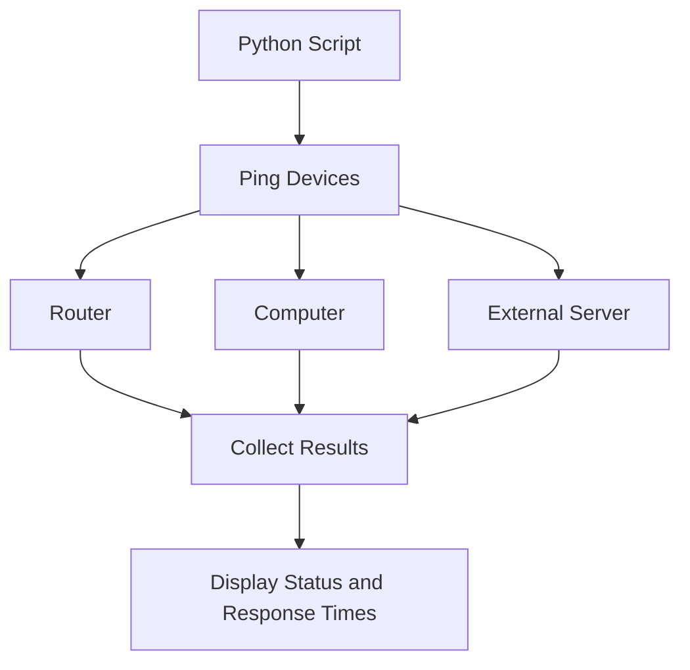

# Network Monitoring Tool

A Python project for checking network device connectivity and measuring response times.

The application uses ICMP ping requests to check whether devices on a network are reachable. It was built to explore network programming, concurrent execution, and basic network diagnostics.

## Features

- Checks connectivity to multiple IP addresses
- Reports whether devices respond to ping requests
- Measures response times
- Uses Python's `ThreadPoolExecutor` to run checks concurrently
- Handles command timeouts and failed requests
- Displays monitoring results in the terminal

## How It Works

The program runs ping commands against a list of configured IP addresses. Each check returns a status and response time, which are then displayed in the terminal.



Concurrent execution allows the program to check multiple devices without waiting for each check to finish before starting the next.

A device that does not respond to ping is reported as unreachable, although this can also occur when ICMP traffic is blocked.

## Technologies

- **Python** — Main application logic
- **ICMP / Ping** — Network connectivity checks
- **Concurrent Futures** — Running multiple checks simultaneously
- **Git / GitHub** — Version control

## Getting Started

### Requirements

- Python 3
- macOS, Linux, or Windows
- Access to a network

### Installation

Clone the repository:

```bash
git clone https://github.com/ashrithkanala/network-monitoring-tool.git
cd network-monitoring-tool
```

Run the program:

```bash
python3 monitor.py
```

### Configuration

IP addresses can be modified in `monitor.py`:

```python
DEVICES = {
    "Home Router": "192.168.0.1",
    "Google DNS": "8.8.8.8",
    "Cloudflare DNS": "1.1.1.1"
}
```

Replace these addresses with devices you want to monitor.

## Future Improvements

I plan to expand the project with:

- PostgreSQL for storing monitoring history
- FastAPI endpoints for retrieving device information
- Scheduled monitoring at regular intervals
- Uptime calculations and outage tracking
- Docker for running the application in a consistent environment
- Unit tests for monitoring functions

## About

This project is part of my work with Python and computer networking. The goal is to build a useful monitoring tool while gaining more experience with backend development, databases, and network programming.
