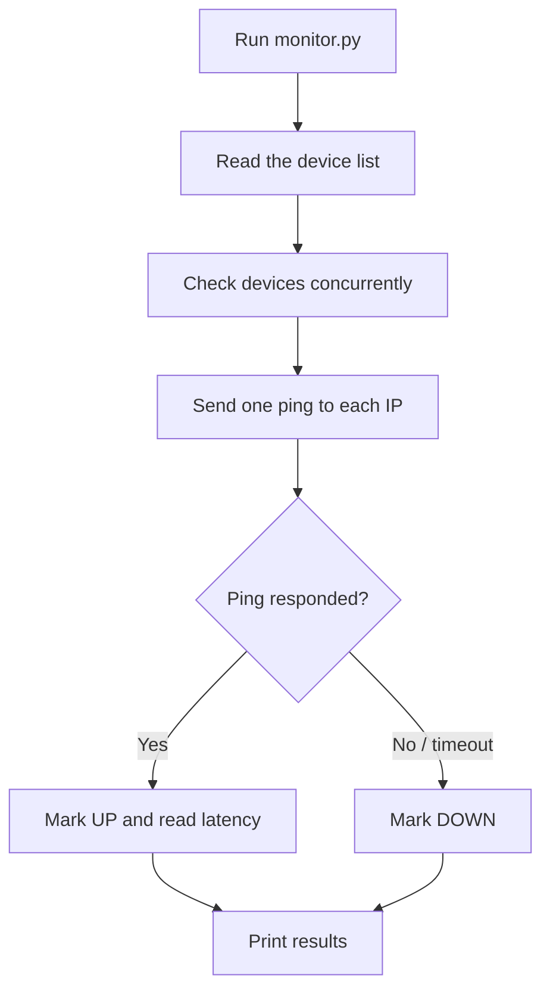
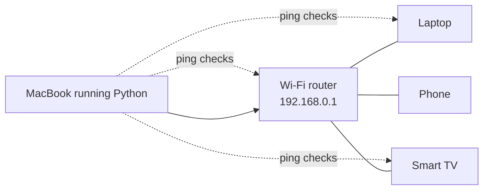
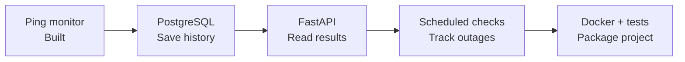

# Network Monitoring Tool

A small Python project for checking whether devices on a network are responding and how long their ping replies take.

I started this to get more hands-on with Python and networking. The idea is simple: instead of opening a terminal and pinging each device myself, I can keep a list of addresses and check them all in one run. I'm building it out in stages, with a database and API planned for later.

## How it works



The monitor uses the computer's built-in `ping` command. Python starts a check for each configured device, reads the response, and reports its status. A thread pool lets multiple checks run at the same time rather than waiting for each one to finish.

### Example home network



The addresses and devices above are just an example. Devices can block ping requests or stop responding while asleep, so **no ping response doesn't always mean a device is offline**.

## What works now

- Checks a list of IP addresses with ICMP ping
- Runs checks concurrently using Python's `ThreadPoolExecutor`
- Reports whether each address responded (`UP` / `DOWN`)
- Extracts ping response time in milliseconds when available
- Adds a UTC timestamp to each result
- Works with the system `ping` command on macOS, Linux, and Windows

## Getting started

You'll need Python 3 and Git. No third-party Python packages are required for this version.

Clone the repository and enter the folder:

```bash
git clone https://github.com/ashrithkanala/network-monitoring-tool.git
cd network-monitoring-tool
```

Run the monitor:

```bash
python3 monitor.py
```

On Windows, you may need to use `python monitor.py` instead.

### Choose which devices to check

Open `monitor.py` and edit the `DEVICES` dictionary:

```python
DEVICES = {
    "Home Router": "192.168.0.1",
    "Google DNS": "8.8.8.8",
    "Cloudflare DNS": "1.1.1.1",
}
```

`192.168.0.1` is the router address on my test network; yours may be different. On a Mac, you can find your default gateway with:

```bash
route -n get default | grep gateway
```

Only monitor devices on networks you own or have permission to test.

### Example output

```text
Home Router (192.168.0.1): UP | latency: 7.49 ms
Google DNS (8.8.8.8): UP | latency: 18.2 ms
Cloudflare DNS (1.1.1.1): DOWN | latency: None ms
```

These are illustrative results, not a live test. Response times depend on the network, and some devices don't answer ping requests.

## Project structure

```text
network-monitoring-tool/
├── monitor.py     # Device list and ping checks
├── README.md      # Project notes and setup
└── .gitignore     # Files Git should ignore
```

## Next steps



I plan to add:

1. **PostgreSQL:** Save device status, latency, and check timestamps so I can look back at previous results.
2. **FastAPI:** Expose endpoints for device lists, current status, and monitoring history.
3. **Scheduled checks:** Run the monitor periodically and track outages and recovery.
4. **Docker and tests:** Make the project easier to run and verify that the monitoring logic works.

## Things I've learned so far

This project has been a practical way to work with Python functions, dictionaries, subprocesses, regular expressions, and concurrent tasks. It has also helped me understand ICMP, IP addresses, latency, and why a failed ping isn't the same as a confirmed outage.

## Limitations

Right now this is a command-line tool, not a continuously running monitoring service. It doesn't store results between runs, discover devices automatically, or send alerts yet. Ping latency is parsed from the operating system's output, so its availability and formatting can vary by platform.
